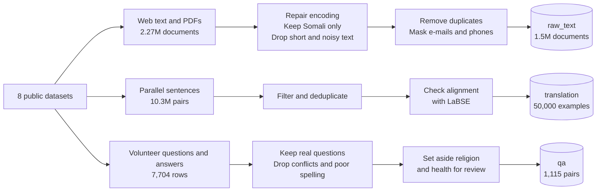

# Somali AI — DataV1

**One clean, deduplicated Somali dataset, ready for training a Somali language model.**
Somali text is scattered across large multilingual collections that overlap, repeat themselves
and carry errors. This project merges eight of them into three training-ready sets: raw Somali
text, Somali↔English translation examples, and human-written question–answer pairs.

Version 1.0 · built 2026-11-15 · Standard Somali (Latin script)

## At a glance

| Set | What it teaches a model | Size | Format |
|---|---|---|---|
| [`raw_text`](final/v1.0/raw_text) | To read and write fluent Somali | 1,505,050 documents · 520 million words · about 1.36 billion tokens | Parquet |
| [`translation`](final/v1.0/translation) | To translate between Somali and English | 50,000 examples | JSONL chat `messages` |
| [`qa`](final/v1.0/qa) | To answer questions in Somali | 1,115 pairs (+ 1,036 held for expert review) | JSONL chat `messages` |

Every record carries its `source` and `license`. Each set is split into train / validation / test
(96% / 2% / 2%). Total size: about 1.1 GB.

## What this project adds

The text itself comes from public datasets. The contribution is the work that turns them into
data a model can be trained on.

1. **One corpus instead of four overlapping ones.** FineWeb-2, HPLT v2, MADLAD-400 and FinePDFs
   were merged and deduplicated against each other. 707,977 duplicate documents were removed, 32%
   of the cleaned input. What remains is 1,505,050 documents and 520 million words. For scale,
   SomaliWeb v1 has 819,322 documents and 233 million words.
2. **Cleaning made for Somali.** Apostrophes, which are letters in Somali spelling (*su'aal*,
   *go'aan*), were unified to one character in 1,020,756 documents. A language identifier
   that handles Somali well removed 22,314 non-Somali documents. Another 32,970 noisy or spam
   documents were dropped, and e-mail addresses and phone numbers were masked in 138,572 documents.
3. **Defects found in the sources and fixed.** HPLT v2 "cleaned" contains 162,094 exact repeats of
   its own documents. MADLAD-400 stores line breaks as literal `\n`; on pages that it
   shares with FineWeb-2, duplicate detection caught 16% before the fix and 70% after.
4. **A translation set built to protect Somali quality.** Two measurements shaped it. The usual
   alignment model (LaBSE) scores correct professional Somali translations low, so one threshold
   would discard a third of the human translations. And NLLB pairs, which are matched
   automatically, are noisy: 60% of a 90,000-pair sample failed the alignment check, and many of
   the Somali sentences that passed read as machine translation. The set therefore uses human
   translations in both directions and NLLB only as Somali→English.
5. **A question–answer set that is sorted, not just copied.** Of 3,695 unique volunteer-written
   questions, 1,115 passed the checks for conflicting answers and spelling. Another 1,036 on
   religion and health are held back for expert review instead of being trained on blindly.
6. **Ready for training, and checkable.** One schema, plain chat `messages`, fixed
   train / validation / test splits, every record validated, and a guard that keeps test-set text
   out of the training data. The pipeline and samples of everything it removed are in this
   repository, so every number above can be reproduced.
7. **A measurement for model choice.** The Qwen3 tokenizer needs 2.62 tokens per Somali word on
   this corpus.

## How it was built



No website was scraped and no data was generated with an AI model. The text was not rewritten:
the pipeline only removed records and made mechanical repairs. Counts for every step are in the
[DATACARD](final/v1.0/DATACARD.md).

## What a record looks like

**`raw_text`** — one web page or document per row.

| Field | Example |
|---|---|
| `id` | `so-raw-0000001` |
| `text` | the full cleaned document |
| `source` | `fineweb2`, `hplt2`, `madlad400` or `finepdfs` |
| `license` | `odc-by-1.0` or `cc0-1.0` |

**`translation`** — one instruction and its answer.

```json
{"id": "so-tr-0041929",
 "messages": [
   {"role": "user", "content": "Turjum af Soomaali: In the winter you need to dress warmly."},
   {"role": "assistant", "content": "Wakhtiga jiilaalka waxa muhiimad gaar ah leh in uu qofku si dugsoon u labisto."}],
 "source": "infopankki", "category": "translation", "language": "so-en", "license": "cc-by-4.0"}
```

**`qa`** — one question and its answer.

```json
{"id": "so-qa-0000874",
 "messages": [
   {"role": "user", "content": "Soomaliya imisa Webi ayaa ku taalo?"},
   {"role": "assistant", "content": "Soomaaliya waxa ku taalo labo Webi Oo Kala Ah:-\n1. Webiga Jubba\n2. Webiga Shabeele"}],
 "source": "aya", "category": "qa_general", "language": "so", "license": "apache-2.0"}
```

The instruction sets store plain `messages`. The chat template of the base model is applied by
the training framework and is not stored in the data.

## Quick start

```python
from datasets import load_dataset

raw = load_dataset("parquet", data_files={
    "train": "final/v1.0/raw_text/train-*.parquet",
    "validation": "final/v1.0/raw_text/validation-*.parquet",
    "test": "final/v1.0/raw_text/test-*.parquet"})

translation = load_dataset("json", data_files={
    "train": "final/v1.0/translation/train.jsonl",
    "validation": "final/v1.0/translation/validation.jsonl",
    "test": "final/v1.0/translation/test.jsonl"})

qa = load_dataset("json", data_files={
    "train": "final/v1.0/qa/train.jsonl",
    "validation": "final/v1.0/qa/validation.jsonl",
    "test": "final/v1.0/qa/test.jsonl"})
```

## Repository map

| Path | Content |
|---|---|
| `final/v1.0/` | The three training-ready sets and the [DATACARD](final/v1.0/DATACARD.md) |
| `final/v1.0/qa/needs_review.jsonl` | Religion and health questions. Not training data until an expert approves them |
| `processed/` | Every translation pair that passed cleaning, with its alignment score |
| `test_quarantine/` | Evaluation data (Belebele). Never train on it |
| `licenses/` | [SOURCES.md](licenses/SOURCES.md): every dataset inspected and the decision. [ATTRIBUTION.md](licenses/ATTRIBUTION.md): required credits |
| `logs/` | Up to 100 random examples of what each cleaning step removed, plus the raw statistics |
| `scripts/` | The pipeline that produced this version |

## Where the data comes from

All data was taken from the public datasets below, downloaded on 2026-11-15.

| `source` | Dataset and publisher | Where the text originally comes from | Licence | In this version |
|---|---|---|---|---|
| `fineweb2` | [FineWeb-2](https://huggingface.co/datasets/HuggingFaceFW/fineweb-2), `som_Latn` — Hugging Face | Public web pages collected by Common Crawl, 2013–2024 | ODC-BY 1.0 | 872,360 documents |
| `hplt2` | [HPLT v2 cleaned](https://huggingface.co/datasets/HPLT/HPLT2.0_cleaned), `som_Latn` — HPLT project | Public web pages, mostly from the Internet Archive, some from Common Crawl | CC0 1.0 | 422,725 documents |
| `madlad400` | [MADLAD-400](https://huggingface.co/datasets/allenai/MADLAD-400) v1.5 clean, `so` — Google, hosted by Allen AI | Public web pages collected by Common Crawl up to August 2022 | ODC-BY 1.0 | 189,598 documents |
| `finepdfs` | [FinePDFs](https://huggingface.co/datasets/HuggingFaceFW/finepdfs), `som_Latn` — Hugging Face | Public PDF documents found by Common Crawl, 2013–2025 (for example government, NGO and school documents) | ODC-BY 1.0 | 20,367 documents |
| `nllb` | [NLLB v1 mined bitext](https://opus.nlpl.eu/legacy/NLLB-v1.php), English–Somali — Meta AI, distributed by OPUS | Sentence pairs matched automatically from Common Crawl and ParaCrawl web text | ODC-BY 1.0 | 28,138 examples, Somali→English only |
| `infopankki` | [OPUS Infopankki](https://huggingface.co/datasets/Helsinki-NLP/opus_infopankki) v1, English–Somali — City of Helsinki, distributed by OPUS | Human translations of infopankki.fi, a public information site for immigrants in Finland | CC-BY 4.0 | 9,752 pairs, both directions |
| `smol` | [SMOL](https://huggingface.co/datasets/google/smol) (SmolSent, SmolDoc), English→Somali — Google | English texts translated into Somali by professional translators | CC-BY 4.0 | 1,179 pairs, both directions |
| `aya` | [Aya Dataset](https://huggingface.co/datasets/CohereLabs/aya_dataset), Somali rows — Cohere Labs and the Aya open-science community | Questions and answers written by 77 volunteer Somali speakers | Apache 2.0 | 1,115 pairs + 1,036 held for review |
| test only | [Belebele](https://huggingface.co/datasets/facebook/belebele), `som_Latn` — Meta AI | Reading-comprehension questions on FLORES-200 passages | CC-BY-SA 4.0 | 900 questions in `test_quarantine/` |

The only text written for this project is a set of 16 short Somali instruction templates in the
translation set (for example "Turjum af Ingiriisi: …"). An AI model wrote them and a native
speaker should check them.

The exact dataset revisions are recorded in [SOURCES.md](licenses/SOURCES.md).

<details>
<summary><b>Datasets inspected and deliberately not used</b></summary>

| Dataset | Reason |
|---|---|
| SomaliWeb v1 | Share-alike licence (CC-BY-SA), and 28.5% of it comes from CC100, whose licence is unclear. Awaiting a legal decision. |
| Somali Wikipedia | Share-alike licence (CC-BY-SA). Awaiting the same decision. |
| `maanka2/somali-web-corpus`, AfriBERTa corpus, XL-Sum | Text scraped from BBC Somali and other news sites, or non-commercial licence. |
| CCMatrix, CC100, OSCAR, `somast/somali-nlp-corpus` | Licence not stated, or access is gated. |
| Aya Collection (Somali), Alpaca-Somali sets, `Zyroxx66/Somali-Reasoning-Dataset`, MURI-IT | Machine-translated or synthetic instructions, not human-written. |
| `yacdev` Somali conversation sets | Synthetic dialogues with template-like wording. |
| Multi-Wiki-QA, Afri-MCQA | Non-commercial licence. |
| `unkadlabs/qor-af-soomaali` | Share-alike licence (CC-BY-SA). |

</details>

## Read this before training

1. **No human editor has reviewed this version.** Quality rests on automatic filters and samples.
2. **Licences were checked at dataset level only.** The web datasets contain text written by many
   third parties, and a dataset licence does not settle the rights in those pages. Get legal
   review before training a commercial model.
3. **The question–answer set is small and not fact-checked.** Answers were written by volunteers;
   spelling and accuracy are uneven. It is far below the 100,000-example goal.
4. **Machine-translated Somali exists in the sources.** Some web pages and many NLLB sentences were
   machine-translated. NLLB is therefore used only as Somali→English, never as a Somali answer.
5. **Personal data masking is limited** to e-mail addresses and phone numbers. Names and addresses
   are not masked, and no toxicity filter was applied.
6. **Standard Somali only.** Af-Maay text is removed by the language filter.

The full list is in section 6 of the [DATACARD](final/v1.0/DATACARD.md).

## What comes next

1. Editor review of the question–answer set, and expert review of `needs_review.jsonl`.
2. More instruction data: editor-written and document-based question–answer pairs, multi-turn chat.
3. A legal decision on the share-alike sources (SomaliWeb v1, Wikipedia).
4. FLORES+ in `test_quarantine/` and a repeat of the test-leakage check.

<details>
<summary><b>Rebuild from the sources</b></summary>

```
python3 scripts/00_download.py raw test_quarantine
python3 scripts/10_stage1_clean.py raw work work/glotlid/model.bin
python3 scripts/20_stage2_dedup_write.py work .
python3 scripts/30_parallel_candidates.py raw work . work/glotlid/model.bin
python3 scripts/31_parallel_labse.py work work/labse
python3 scripts/32_parallel_build.py work .
python3 scripts/35_qa_build.py raw work . work/glotlid/model.bin
python3 scripts/40_validate.py . work
python3 scripts/50_datacard.py work .
```

Needs `datasets huggingface_hub pyarrow ftfy xxhash fasttext sentence-transformers`, the GlotLID
model (`cis-lmu/glotlid`, `model.bin`) and LaBSE (`sentence-transformers/LaBSE`). The raw downloads
(about 3.9 GB) are not stored in this repository.

</details>

## Licence and credits

The data keeps the licences of its sources: ODC-BY 1.0, CC0 1.0, CC-BY 4.0 and Apache 2.0, shown
per record in the `license` field. Required credits are in [ATTRIBUTION.md](licenses/ATTRIBUTION.md).
